# CRUD - Node.js - JWT

## ENDPOINTS

### Auth

- `GET /auth` - Mostra la pàgina de login i registre i **_renderitza_** la vista EJS.
  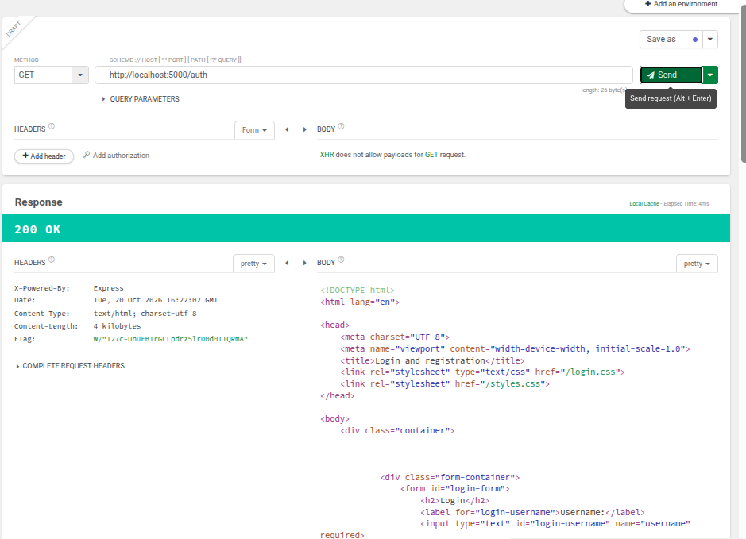

- `POST /auth/register` - Registra un usuari nou i **_crea_** el token de sessió amb cookie.
  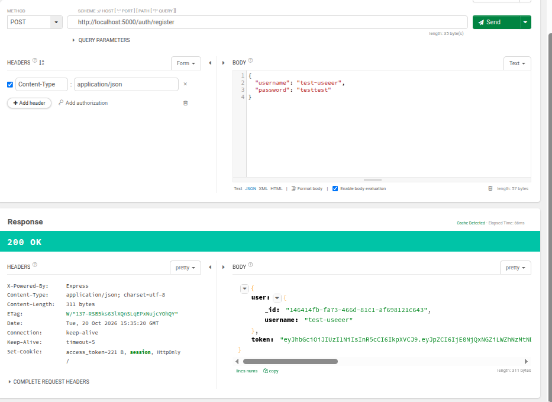

- `POST /auth/login` - Inicia sessió i **_crea_** la cookie JWT amb les credencials validades.
  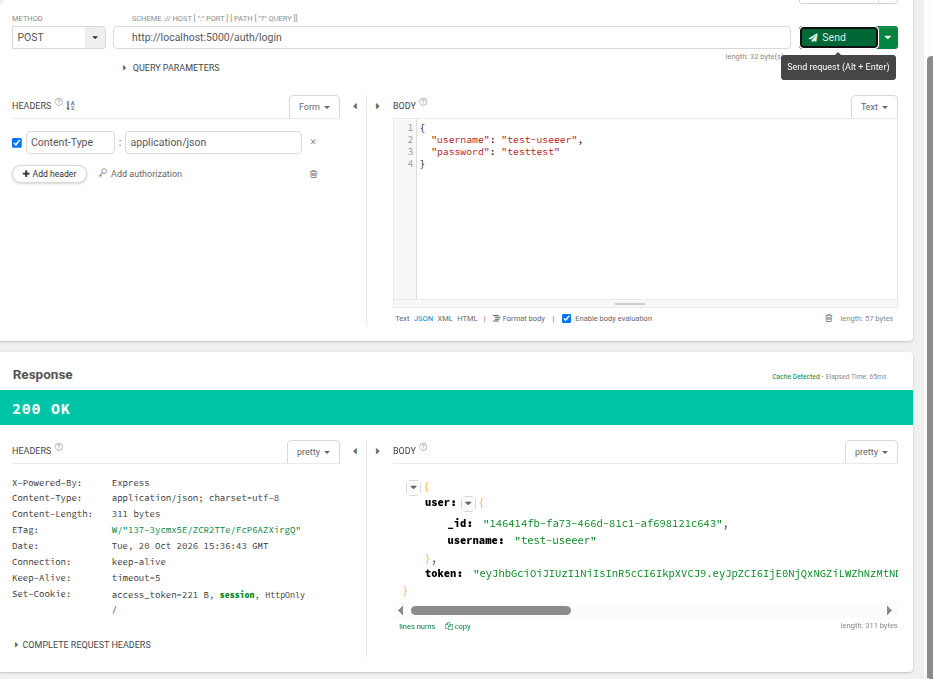

- `GET /auth/protected` - Mostra la pàgina protegida si l'usuari està autenticat, o la vista de permisos si no ho està; **_renderitza_** la resposta adequada.
  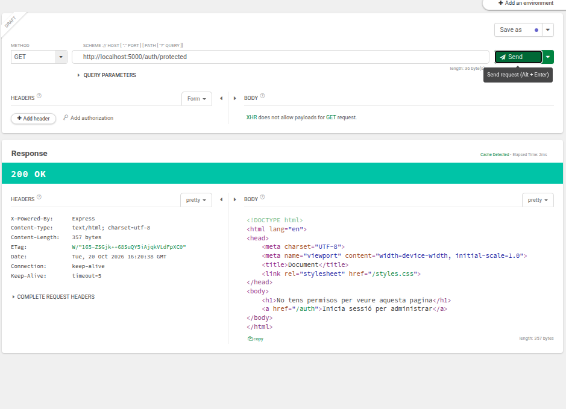

- `POST /auth/logout` - Tanca la sessió i **_esborra_** la cookie de l'usuari, després **_renderitza_** la vista principal.
  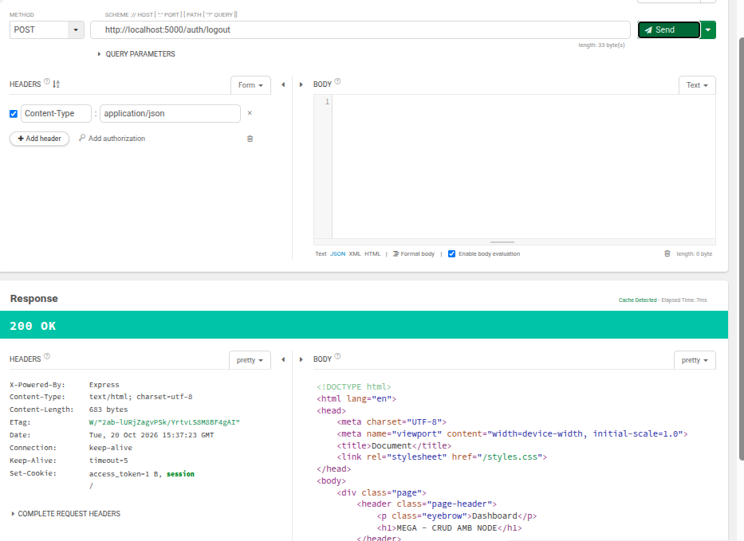

### Games

- `GET /games` - Mostra la llista de jocs i **_renderitza_** la vista EJS si l'usuari està autenticat.
  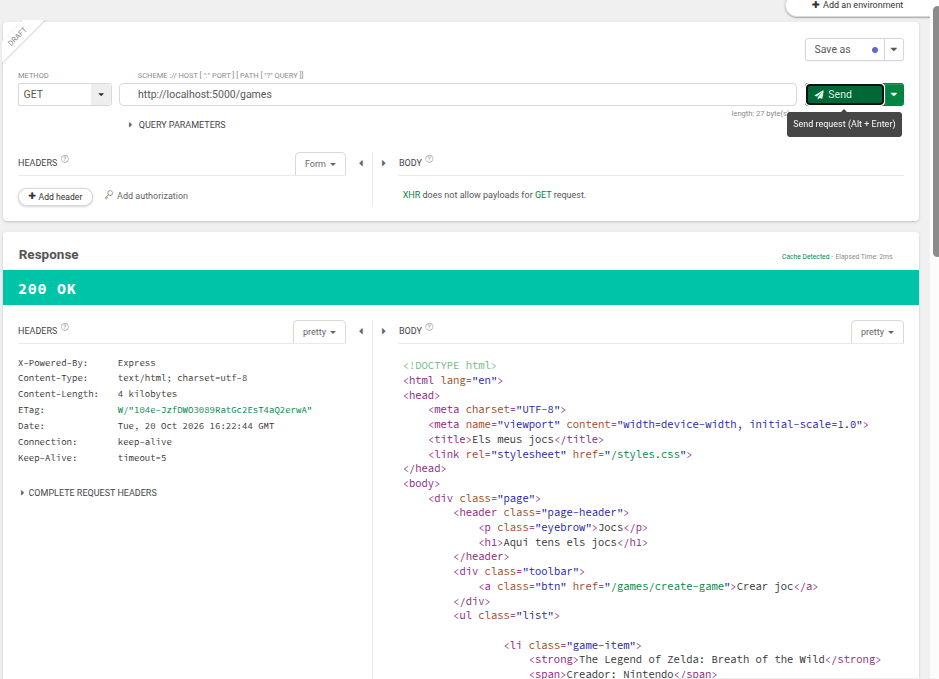

- `GET /games/create-game` - Mostra el formulari per crear un nou joc i **_renderitza_** la vista corresponent.
  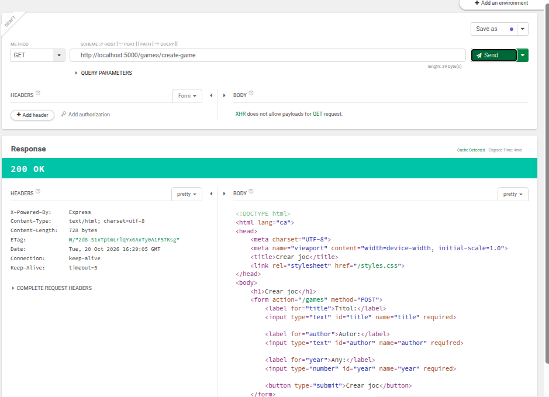

- `GET /games/:id` - Carrega el joc concret i **_renderitza_** l'edició EJS del registre.
  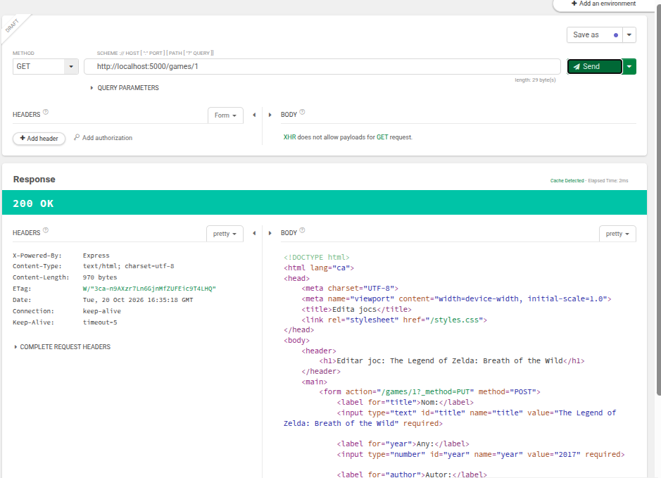

- `POST /games` - Crea un nou joc i **_redirigeix_** a `/games` després d'emmagatzemar-lo.
  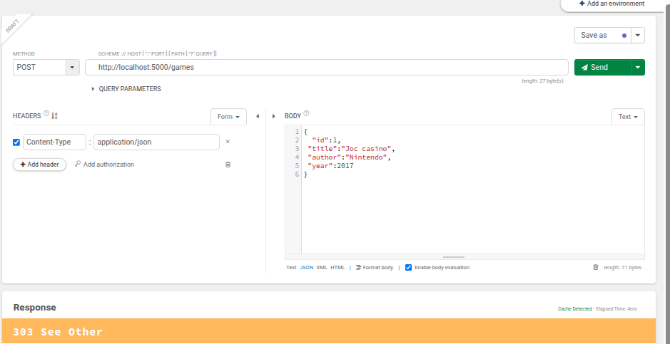

- `PUT /games/:id` - Actualitza un joc existent i **_redirigeix_** a `/games`.
  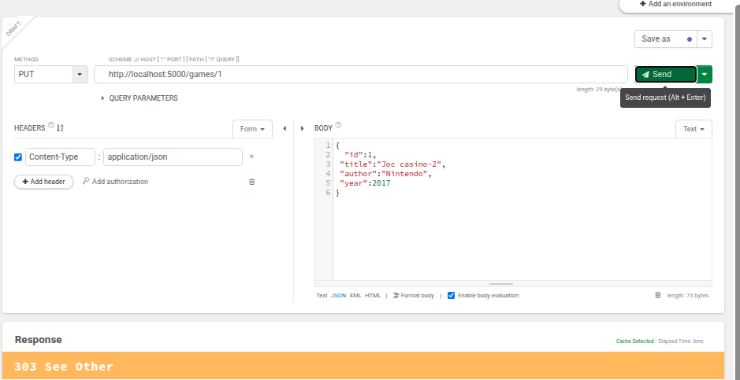

- `DELETE /games/:id` - Elimina un joc i **_redirigeix_** a `/games`.
  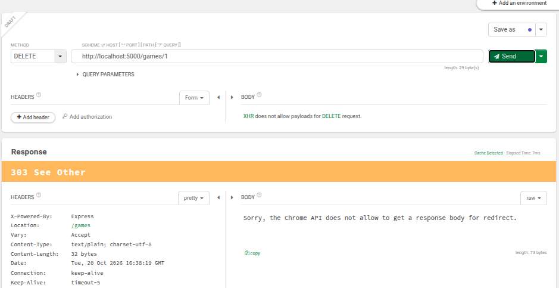

### Movies

- `GET /movies` - Mostra la llista de pel·lícules i **_renderitza_** la vista EJS si l'usuari està autenticat.
  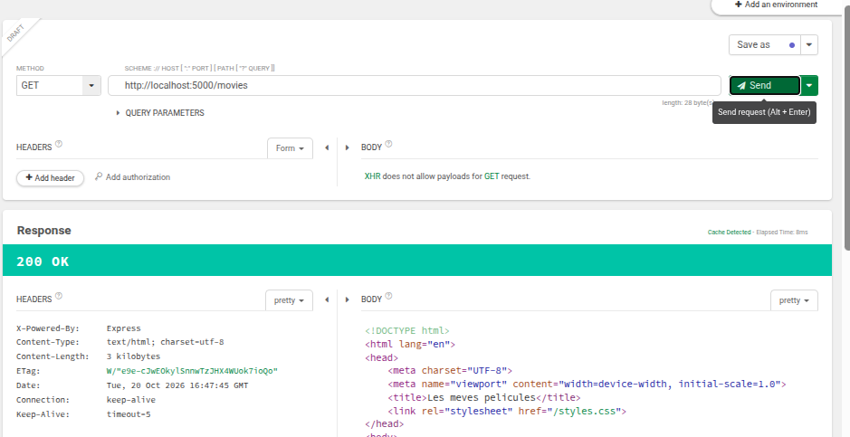

- `GET /movies/create-movie` - Mostra el formulari per crear una nova pel·lícula i **_renderitza_** la vista corresponent.
  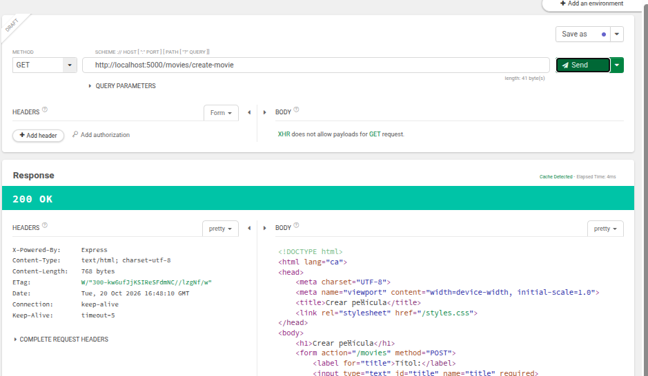

- `GET /movies/:id` - Carrega la pel·lícula concreta i **_renderitza_** l'edició EJS del registre.
  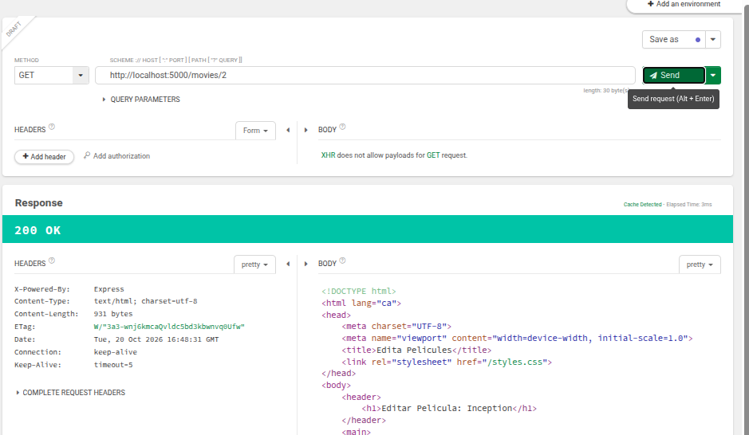

- `POST /movies` - Crea una nova pel·lícula i **_redirigeix_** a `/movies` després d'emmagatzemar-la.
  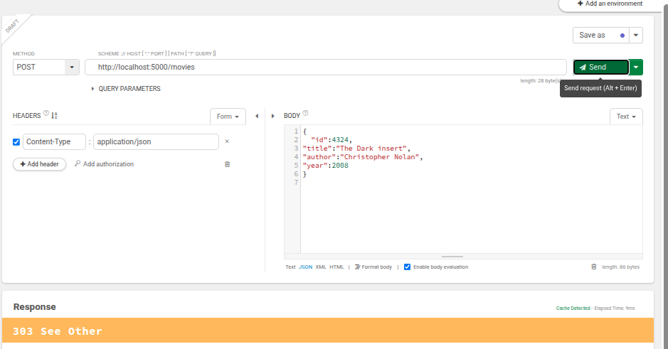

- `PUT /movies/:id` - Actualitza una pel·lícula existent i **_redirigeix_** a `/movies`.
  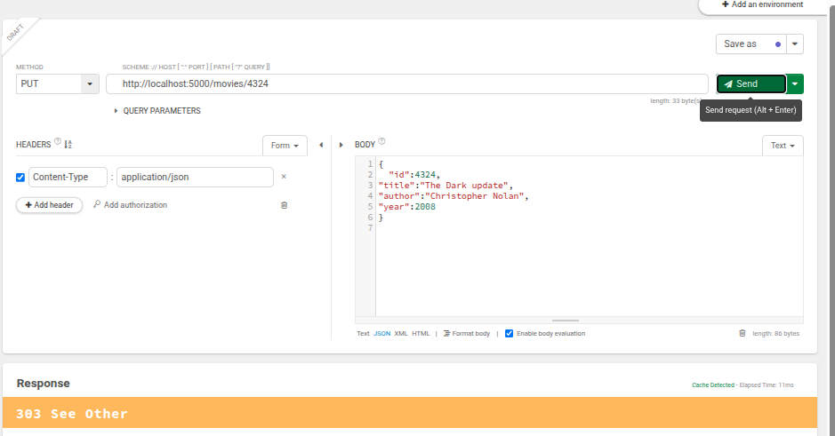

- `DELETE /movies/:id` - Elimina una pel·lícula i **_redirigeix_** a `/movies`.
  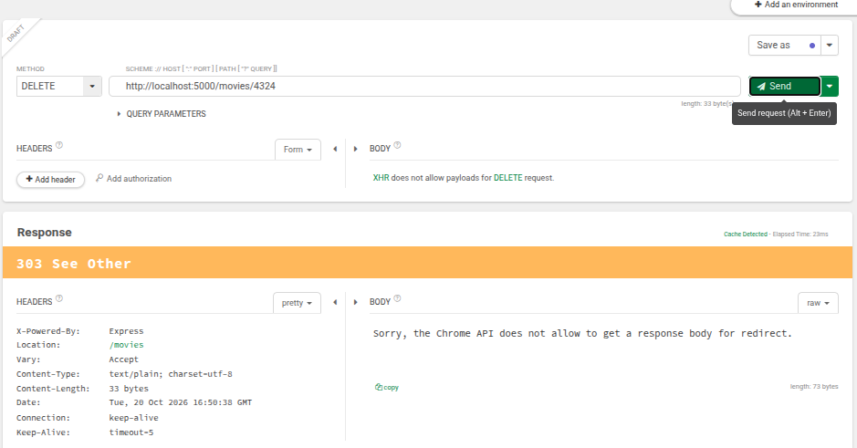
